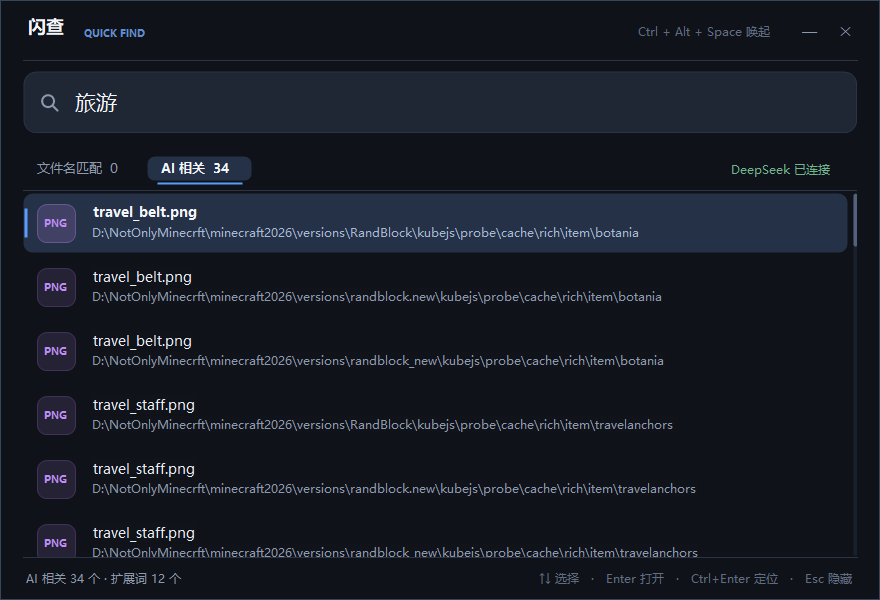

# 闪查 QuickFind

一个在本机快速定位文件位置的小工具。双击即可运行，不需要安装，也不需要打开任何其他软件。



- 程序：`dist\QuickFind.exe`（Windows x64 单文件，自带运行时，约 52 MB）
- 桌面快捷方式：`闪查 QuickFind` → `%LOCALAPPDATA%\Programs\QuickFind\QuickFind.exe`
- 数据目录：`%LOCALAPPDATA%\QuickFind`
- 本地索引不联网；只有使用“AI 相关”时，搜索词会发送给网页版 DeepSeek。

## 使用方法

1. 双击 `QuickFind.exe` 启动。首次运行会在后台扫描本机文件并建立索引，界面左下角会显示进度。
2. 在搜索框输入文件名或路径片段，结果会实时出现。
3. 结果分为两个分栏：
   - **文件名匹配**：文件名中包含全部搜索词的文件，传统精确匹配。
   - **AI 相关**：把搜索词交给网页版 DeepSeek 扩展为同义词/相关词，再匹配出的本地文件；文件名已直接匹配的文件会被排除。
4. 点击分栏切换。`↑` `↓` 选择结果，`Enter` 打开文件，`Ctrl+Enter` 在资源管理器中定位文件。
5. 也可以直接双击结果打开，或右键使用“复制完整路径 / 打开所在位置”。
6. 关闭窗口后程序退出；点击最小化按钮会缩到系统托盘，按热键可随时唤起。

### 快捷键

| 快捷键 | 作用 |
| --- | --- |
| `Ctrl + Alt + Space` | 显示 / 隐藏闪查（若被占用会自动改用 `Ctrl + Alt + F`） |
| `Enter` | 打开选中的文件 |
| `Ctrl + Enter` | 打开文件所在位置并选中它 |
| `Ctrl + C` | 复制选中文件的完整路径 |
| `Esc` | 隐藏窗口（程序继续在托盘运行） |
| `F5` | 重新扫描并建立索引 |

### 搜索技巧

- 多个关键词用空格分隔，所有关键词都要匹配，例如：`下载 报告`。
- **文件名匹配**只检查文件名；**AI 相关**会检查文件名和路径，所以可以找到“放在旅行文件夹里的行程表”这类文件。
- 不区分英文大小写；中文文件名直接输入即可。
- 默认最多展示 240 条文件名匹配、120 条 AI 相关结果，底部会显示总匹配数。

## 网页版 DeepSeek

- 点击右上角“连接 DeepSeek”（或 AI 分栏里的按钮）后，应用会内嵌打开 `chat.deepseek.com`。
- 如果浏览器里已经登录、或网页直接进入对话页，应用会自动完成连接并隐藏网页窗口；否则请在弹出的窗口里登录一次，登录状态会保存在本机。
- 每次搜索时，应用会向 DeepSeek 发送**搜索词本身**，请它返回相关关键词；**不会上传本机文件列表或路径**。随后在本地完成文件匹配。
- AI 是“关键词扩展”，不是把每个文件都发给 AI；结果仍可能包含宽泛匹配，建议结合分栏和关键词使用。
- DeepSeek 网页改版、网络不可用或需要验证码时，AI 分栏可能失败；文件名匹配不受影响。
- 想查看 DeepSeek 网页或切换账号，点击“DeepSeek 已连接”即可重新打开窗口。

> 需要 Microsoft Edge WebView2 运行时。Windows 11 通常已自带；如果提示缺失，安装微软官方的 Evergreen WebView2 Runtime 即可。

## 索引说明

- 只扫描本机的固定磁盘和已就绪的移动磁盘，不扫描网络驱动器。
- 会跳过无法访问的目录、系统卷信息目录和目录联接（避免循环扫描）。
- 首次索引通常需要一到几分钟；之后启动会直接读取缓存，基本秒开。
- 如果缓存超过 10 分钟，启动时会在后台自动更新；也可以随时按 `F5` 手动重建。
- 需要清空索引时，退出程序后删除 `%LOCALAPPDATA%\QuickFind\index.bin` 即可。

## 兼容性

- Windows 10 / Windows 11，64 位。
- 单文件版本已包含 .NET 运行时，目标电脑无需安装 .NET。
- 程序没有数字签名，Windows SmartScreen 可能提示“未知发布者”；选择“更多信息 → 仍要运行”即可。

## 从源码构建

需要 .NET 10 SDK：

```powershell
dotnet publish .\QuickFind.csproj -c Release -r win-x64 --self-contained true `
  -p:PublishSingleFile=true -p:EnableCompressionInSingleFile=true -o .\dist
```

生成结果：`dist\QuickFind.exe`。WebView2Loader 已嵌入 exe，首次使用时会释放到数据目录。

## 目录结构

```
QuickFind/
├─ Program.cs              启动、单实例、异常处理
├─ MainForm.cs             主界面、分栏、索引调度
├─ FileIndex.cs            索引快照、直接匹配与 AI 相关匹配
├─ IndexBuilder.cs         磁盘遍历
├─ DeepSeekSession.cs      网页版 DeepSeek 问答与关键词解析
├─ DeepSeekWindow.cs       内嵌 DeepSeek 登录/对话窗口
├─ WebView2Bootstrap.cs    单文件版 WebView2Loader 释放与加载
├─ Ui.cs                   暗色控件与绘制
├─ NativeMethods.cs        全局热键、窗口圆角等 Win32 调用
├─ app.manifest            长路径与权限声明
└─ assets/                 图标与预览图
```
